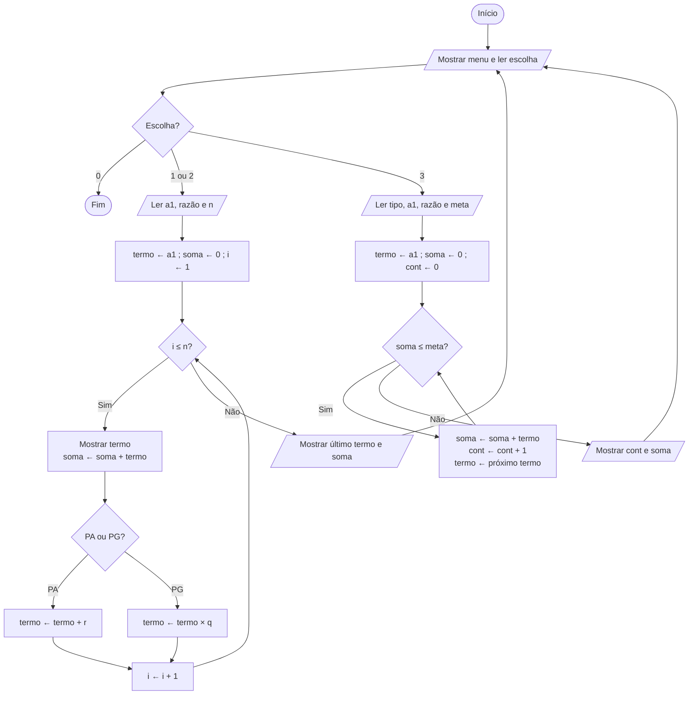

# PA & PG LAB — Relatório

> Progressões Aritméticas e Geométricas com Pensamento Computacional.
>
> 🔗 **Frontend online:** https://errarehumest.github.io/papgtrabalho/
> 💻 **Código-fonte:** https://github.com/errarehumest/papgtrabalho

---

## Etapa 1 – Planejamento

**1. O que é preciso para construir uma PA?**
O primeiro termo (a₁), a razão (r) e a quantidade de termos (n).

**2. O que é preciso para construir uma PG?**
As mesmas informações: o primeiro termo (a₁), a razão (q) e a quantidade de termos (n).

**3. Como achar o próximo termo de uma PA?**
Somando a razão ao termo atual: `próximo = atual + r`.

**4. Como achar o próximo termo de uma PG?**
Multiplicando o termo atual pela razão: `próximo = atual × q`.

**5. Como calcular a soma dos termos gerados?**
Usando um **acumulador**: a variável `soma` começa em 0 e, a cada repetição, recebe o termo
que acabou de ser gerado (`soma ← soma + termo`). No fim do laço, ela guarda a soma de todos os termos.

### 6. Pseudocódigo

```text
INÍCIO
  REPITA
    MOSTRAR menu (1 - PA | 2 - PG | 3 - Meta | 0 - Sair)
    LER escolha

    SE escolha = 1 OU escolha = 2 ENTÃO
        LER primeiro, razao, quantidade
        termo ← primeiro
        soma  ← 0
        PARA i DE 1 ATÉ quantidade FAÇA
            MOSTRAR termo
            soma ← soma + termo
            SE escolha = 1 ENTÃO
                termo ← termo + razao        // PA
            SENÃO
                termo ← termo * razao        // PG
            FIM SE
        FIM PARA
        MOSTRAR último termo e soma

    SENÃO SE escolha = 3 ENTÃO
        LER tipo, primeiro, razao, meta
        termo ← primeiro ; soma ← 0 ; contador ← 0
        ENQUANTO soma <= meta FAÇA
            soma ← soma + termo
            contador ← contador + 1
            termo ← próximo termo (PA soma, PG multiplica)
        FIM ENQUANTO
        MOSTRAR contador e soma
    FIM SE
  ATÉ escolha = 0
FIM
```

### Fluxograma



---

## Etapa 2 e 3 – Programa

Código-fonte: [`pa_pg_lab.py`](pa_pg_lab.py).

- `gerar_pa()` e `gerar_pg()` montam a sequência **termo a termo** dentro de um laço `for`
  e acumulam a soma nesse mesmo laço. Nenhuma fórmula pronta é usada para chegar ao resultado.
- `alcancar_meta()` (Etapa 6) usa um laço `while` que continua enquanto `soma <= meta`.
- O programa aceita números decimais com vírgula ou ponto (ex.: `0,5`) e valida o que o usuário digita.

---

## Etapa 4 – Testes

Os quatro testes estão automatizados em [`test_pa_pg_lab.py`](test_pa_pg_lab.py)
(`py -m unittest test_pa_pg_lab.py -v`). Os 10 testes passaram.

### Teste 1 – PA crescente

| Entrada | Valor |
|---|---|
| Primeiro termo | 2 |
| Razão | 4 |
| Quantidade | 8 |

**Saída do programa:** `2, 6, 10, 14, 18, 22, 26, 30` · Último termo: **30** · Soma: **128**

**Verificação:**
- a₈ = a₁ + (n − 1)·r = 2 + 7·4 = **30** ✓
- S₈ = (a₁ + a₈)·n / 2 = (2 + 30)·8 / 2 = **128** ✓

### Teste 2 – PA decrescente

| Entrada | Valor |
|---|---|
| Primeiro termo | 50 |
| Razão | −7 |
| Quantidade | 6 |

**Saída do programa:** `50, 43, 36, 29, 22, 15` · Último termo: **15** · Soma: **195**

**Verificação:**
- a₆ = 50 + 5·(−7) = 50 − 35 = **15** ✓
- S₆ = (50 + 15)·6 / 2 = 65·3 = **195** ✓

### Teste 3 – PG crescente

| Entrada | Valor |
|---|---|
| Primeiro termo | 3 |
| Razão | 2 |
| Quantidade | 7 |

**Saída do programa:** `3, 6, 12, 24, 48, 96, 192` · Último termo: **192** · Soma: **381**

**Verificação:**
- a₇ = a₁·q⁶ = 3·64 = **192** ✓
- S₇ = a₁·(qⁿ − 1)/(q − 1) = 3·(128 − 1)/1 = **381** ✓

### Teste 4 – PG decrescente

| Entrada | Valor |
|---|---|
| Primeiro termo | 1024 |
| Razão | 0,5 |
| Quantidade | 6 |

**Saída do programa:** `1024, 512, 256, 128, 64, 32` · Último termo: **32** · Soma: **2016**

**Verificação:**
- a₆ = 1024·(0,5)⁵ = 1024/32 = **32** ✓
- S₆ = 1024·(0,5⁶ − 1)/(0,5 − 1) = 1024·(−63/64)/(−0,5) = 1008·2 = **2016** ✓

### Exemplos do enunciado (também conferidos)

| Caso | Resultado | Esperado |
|---|---|---|
| PA: 5, 3, 6 termos | 5, 8, 11, 14, 17, 20 · último 20 · soma 75 | ✓ |
| PG: 2, 3, 5 termos | 2, 6, 18, 54, 162 · último 162 · soma 242 | ✓ |
| Meta PG: 2, 2, meta 1000 | 9 termos · soma 1022 | ✓ |

---

## Etapa 5 – Reflexão

**1. Qual foi a principal diferença entre o algoritmo da PA e o da PG?**
Só a operação que gera o próximo termo. Na PA o termo atual é **somado** à razão
(`termo + r`). Na PG ele é **multiplicado** pela razão (`termo * q`). O resto do algoritmo é igual:
começar no primeiro termo, repetir n vezes, mostrar o termo e acumular a soma. Por isso uma única
decisão (`if tipo == "PA"`) basta para trocar de uma progressão para a outra.

**2. Qual foi a função da estrutura de repetição?**
Ela automatiza o padrão da progressão. A cada volta do laço, o programa (a) guarda o termo atual,
(b) soma esse termo ao acumulador e (c) calcula o próximo termo a partir do anterior. O `for`
repete isso exatamente *n* vezes. Na Etapa 6, o `while` repete até uma condição ser atingida
(`soma > meta`), sem saber antes quantas voltas serão necessárias.

**3. Qual foi a maior dificuldade?**
Duas situações:
- Na **PG decrescente**, com razão 0,5, os termos viram números decimais (`float`) e apareciam
  como `32.0`. Em outros casos podiam surgir erros de arredondamento, como `0.30000000000000004`.
- No problema da **meta**, alguns valores fazem o `while` nunca terminar. Uma PA com razão negativa,
  ou uma PG com |q| < 1 (cuja soma converge), nunca passa de uma meta alta.

**4. Como resolveu?**
- Criei a função `normalizar()`, que arredonda o resíduo de ponto flutuante e mostra `32.0` como `32`.
- No `while` da meta, coloquei um **limite de segurança** de 10 000 termos. Se a soma não passar
  da meta até esse limite, o programa avisa que ela provavelmente nunca vai passar, em vez de travar.

---

## Etapa 6 – Alcançando a Meta

Função `alcancar_meta(tipo, primeiro, razao, meta)` em [`pa_pg_lab.py`](pa_pg_lab.py), opção **3** do menu.

```text
Tipo (PA/PG): PG
Primeiro termo: 2
Razão: 2
Meta: 1000

Resultado:
São necessários 9 termos.
Soma obtida: 1022
```

Verificação: S₈ = 2·(2⁸ − 1) = 510 ≤ 1000 e S₉ = 2·(2⁹ − 1) = 1022 > 1000. Portanto, **9** é o
menor número de termos que faz a soma passar da meta. ✓

---

## Etapa 7 – Frontend

Pasta [`frontend/`](frontend/) (HTML + CSS + JavaScript, sem dependências). A interface permite:

- escolher entre **PA** e **PG**;
- informar o primeiro termo, a razão e a quantidade de termos;
- ver a **sequência gerada**, o **último termo** e a **soma dos termos**.

Também traz:
- modo **"Alcançar meta"** (Etapa 6);
- **gráfico** dos termos e da soma acumulada, com tooltip;
- **passo a passo do laço** (tabela com cada repetição);
- **verificação matemática** automática, comparando o laço com as fórmulas;
- **pseudocódigo** atualizado com os valores digitados;
- botões com os testes da Etapa 4 e opção para copiar o resultado no formato do terminal.
